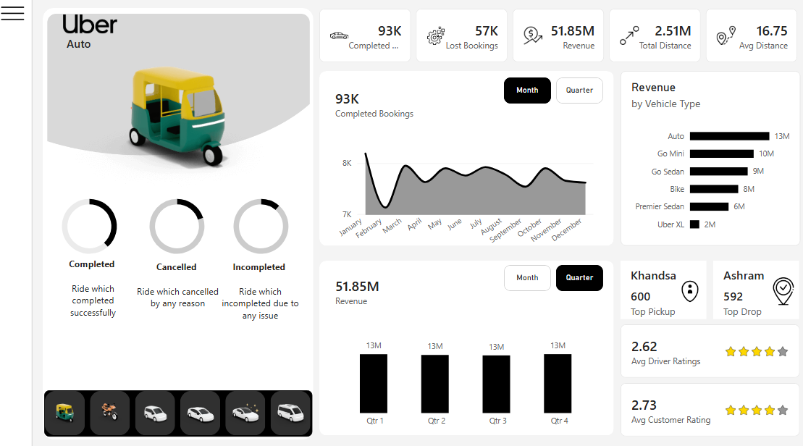

# 🚖 Uber Business & Ride Analytics Dashboard

A comprehensive Power BI business intelligence solution designed to monitor ride completion performance, revenue generation, vehicle category performance, customer ratings, and geographic trip dynamics for Uber operations.

---

## 📊 Project Overview
This project transforms complex ride-hailing operational data into actionable executive insights. It empowers stakeholders to track ride completion vs. cancellation rates, analyze revenue distributions across vehicle types and payment methods, identify peak demand hubs, and optimize fleet management strategies.

---

## 🚀 Key Features & High-Level KPIs

- **Ride Volume Metrics:** Tracks **93K Completed Bookings** against **57K Lost Bookings** (cancellations and incomplete rides).
- **Financial Performance:** Total revenue generated reaching **$51.85M** across quarterly and monthly reporting windows.
- **Distance & Operations:** Total distance covered of **2.51M units** with an average trip length of **16.75 units**.
- **Quality & Ratings:** Operational tracking of service quality with an **Avg Driver Rating of 2.62** and an **Avg Customer Rating of 2.73**.
- **Top Locations:** High-volume pickup hotspot led by **Khandsa (600 trips)** and drop-off hotspot led by **Ashram (592 trips)**.

---

## 📈 Dashboard & Technical Architecture Preview

### Executive Overview Dashboard

---

## 🛠️ Multi-Page Architecture & Technical Execution

* **Overview Page:** Executive summary tracking core KPIs (Completed, Lost Bookings, Revenue, Distances, Driver & Rider Ratings) along with vehicle filters and monthly/quarterly trends.
* **Vehicle Page:** Detailed vehicle performance breakdowns evaluating booking counts, revenue contributions, and category metrics (Auto, Go Mini, Go Sedan, Bike, Premier Sedan, Uber XL).
* **Revenue Page:** Multi-dimensional revenue analysis categorized by Customer, Vehicle Type, Payment Method, and Month/Quarter aggregations.
* **Rider & Cancellation Page:** In-depth customer behavior analysis analyzing cancellation reasons, rider frequency categories (First Time, Returning, Regular Riders), and payment preferences.
* **Location & Logistics Page:** Geographic logistics insights tracking monthly total distances, busy time slots, high-density areas, and vehicle-specific mileage metrics.
* **Interactive UI/UX:** Built-in collapsible Hide/Show filter panel for optimal visual space management, custom vehicle slicers, and seamless page navigation.

---

## 💡 Key Business Insights

- **Vehicle Revenue Leadership:** Auto leads as the highest revenue-generating vehicle segment (**$13M**), followed closely by Go Mini (**$10M**) and Go Sedan (**$9M**).
- **Quarterly Revenue Consistency:** Steady financial quarterly performance maintaining a consistent **$13M revenue output per quarter** (Q1 through Q4).
- **Service Efficiency:** High percentage of lost bookings highlights key opportunities for driver retention, dispatch algorithm optimizations, and cancellation penalty policy adjustments.
